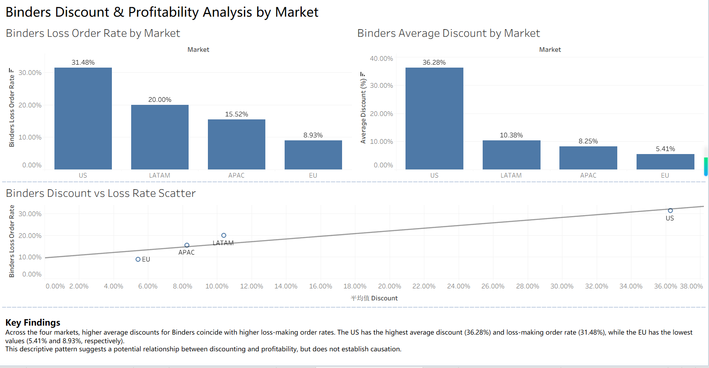

# Binders Discount & Profitability Analysis by Market

## Project Overview

This project examines the relationship between discounting and order-level profitability for the Binders sub-category across four markets: US, LATAM, APAC, and EU.

Using Tableau and the Global Superstore dataset, I developed an interactive dashboard to compare average discount rates and loss-making order rates across markets.

## Business Questions

- How do average discount rates vary across markets?
- Which markets have the highest proportion of loss-making Binders orders?
- Is higher discounting associated with a higher loss-making order rate?

## Dataset and Tools

**Dataset:** Global Superstore, filtered to the Binders sub-category.Data Source: Kaggle (publicly accessible practice dataset). The exact dataset URL and redistribution license have not yet been verified.

**Tool:** Tableau Public.

**Methods:** Data filtering, calculated fields, FIXED Level of Detail (LOD) expressions, order-level aggregation, market comparisons, scatter plots, and linear trend analysis.

## Methodology

To avoid confusing loss-making transaction rows with loss-making orders, I calculated total profit at the market-order level using a FIXED LOD expression:

`{ FIXED [Market], [Order ID] : SUM([Profit]) }`

An order was classified as loss-making when its aggregated profit was negative.

**Loss Order Rate = Number of Loss-Making Orders / Total Number of Orders × 100**

I then compared loss order rates with average discount rates across markets.

## Key Findings

| Market | Average Discount | Loss Order Rate |
|---|---:|---:|
| US | 36.28% | 31.48% |
| LATAM | 10.38% | 20.00% |
| APAC | 8.25% | 15.52% |
| EU | 5.41% | 8.93% |

The US market had both the highest average discount rate and the highest proportion of loss-making Binders orders. The EU market had the lowest values for both measures.

Across the four markets, higher average discounts coincided with higher loss-making order rates.

## Limitations

This analysis is descriptive and does not establish causation. The market-level comparison includes only four observations, limiting the strength of statistical conclusions.

Other factors, including product mix, shipping costs, pricing strategies, and market conditions, may also influence profitability.

## Business Implications

The findings suggest that markets with relatively high discount rates, particularly the US, warrant closer investigation of discount policies and order-level profitability.

Further analysis at the order and product levels would help identify whether specific discount patterns are associated with losses.

## Dashboard

## Project Files

- `binders_dashboard_v2.png` — Dashboard screenshot
- Tableau packaged workbook — Not publicly distributed pending dataset license verification.
